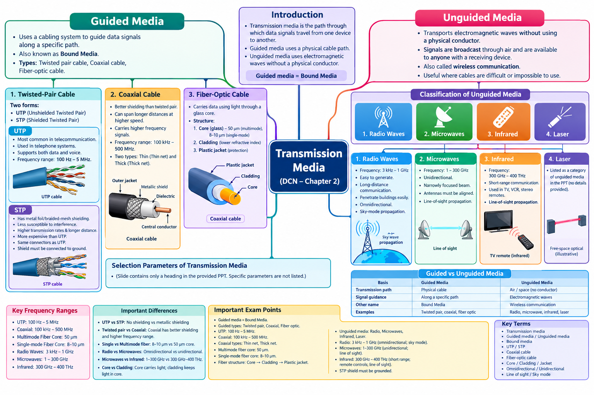

# LJ-DCN-sem3-chapter2-explained

---

# DCN Chapter 2 — Transmission Media

Subject: Data Communication and Networking (DCN) · Source: Your uploaded LJ Polytechnic PPT

We’ll follow your requested workflow in order, using your PPT as the primary source. I’ll preserve its terminology, explain its diagrams and concepts in simple language, and build the question banks with answers immediately after each question.

We’ll begin with Step 1 — Deep Explanation. The mind map, mind map image, MCQs, and mark-wise questions will follow in sequence.

# STEP 1 — Deep Explanation

## 1. Introduction to Transmission Media

Definition: Transmission media is the communication path through which data signals travel from one device to another.

When two computers communicate, data must travel through some medium. That medium may be a physical cable or a wireless path through the air.

For example:

- A computer connected to a router using an Ethernet cable uses guided media.
    
- A laptop connected to Wi-Fi uses unguided media.
    
- A television remote uses infrared waves to communicate with a television.
    

Transmission media is broadly classified into two main categories:

Transmission Media

1. Guided Media

Signals travel through a physical cable.

Also called Bound Media

2. Unguided Media

Signals travel as electromagnetic waves without a physical conductor.

Wireless communication

Important exam point: Guided media uses a physical path; unguided media does not require a physical conductor between the communicating devices.

## 2. Guided Media

### Definition

Guided transmission media uses a cabling system that guides data signals along a specific path. It is also known as Bound Media.

The PPT identifies three types of guided media:

1. Twisted-pair cable
    
2. Coaxial cable
    
3. Fiber-optic cable
    


Twisted-pair cable

Uses pairs of insulated copper wires twisted together. Commonly used in telephone systems and computer networks.


Coaxial cable

Has a central conductor and shielding that protects signals from external interference.


Fiber-optic cable

Carries information using light that propagates through a glass core.

These three cable types are explained separately below.

### 2.1 Twisted-Pair Cable

Twisted-pair cable consists of pairs of insulated conducting wires twisted around each other.

The twisting helps reduce the effect of electrical interference and unwanted signals. The PPT divides twisted-pair cable into two forms:

- Unshielded Twisted-Pair Cable (UTP)
    
- Shielded Twisted-Pair Cable (STP)
    

#### A. Unshielded Twisted-Pair Cable (UTP)

Definition: UTP is a twisted-pair cable that does not have an additional metallic shielding layer around its wire pairs.

According to the PPT, UTP is the most common type of telecommunication medium in use. It is used mostly in telephone systems, and its frequency range is suitable for transmitting both data and voice.


[global.microless.com](https://global.microless.com/product/vention-ibn-cat-6-utp-ethernet-patch-cable-lszh-jacket-1gbps-transmission-speed-oxygen-free-copper-conductor-250mhz-bandwidth-gold-plated-connector-2m-cable-length-black-ibnbh/?utm_source=chatgpt.com)

Important points from the PPT:

1. It is widely used in telecommunication.
    
2. It is mostly used in telephone systems.
    
3. Its frequency range supports both voice and data transmission.
    
4. Its specified frequency range is 100 Hz to 5 MHz.
    

Example: A traditional telephone cable or an Ethernet cable with twisted copper pairs.

#### B. Shielded Twisted-Pair Cable (STP)

Definition: STP is a twisted-pair cable that uses metallic shielding, such as metal foil or braided mesh, to protect the insulated conductors from external interference.


[slideserve.com](https://www.slideserve.com/lass/network-guide-to-networks-fourth-edition-powerpoint-ppt-presentation?utm_source=chatgpt.com)

The shielding acts as a protective barrier against unwanted electrical signals.

Important points from the PPT:

1. It has a metal foil or braided-mesh covering around the insulated conductor pairs.
    
2. Its protective covering provides insulation against outside interference.
    
3. It is less susceptible to electrical interference than UTP.
    
4. It supports higher transmission rates over longer distances than UTP, as stated in the PPT.
    
5. It is more expensive than UTP because of its materials and manufacturing requirements.
    
6. It uses the same connectors as UTP, according to the PPT.
    
7. Its shield must be connected to ground.
    

Example: A shielded network cable used in an environment with significant electrical interference.

Why is grounding important? The shield needs a proper ground connection to help manage unwanted electrical interference.

#### UTP vs STP

|Basis|UTP|STP|
|---|---|---|
|Full form|Unshielded Twisted Pair|Shielded Twisted Pair|
|Metallic shielding|No additional metallic shield|Metal foil or braided-mesh shielding|
|Electrical interference|More susceptible|Less susceptible|
|Cost|Less expensive|More expensive|
|Transmission|Used for voice and data|Supports higher transmission rates over longer distances than UTP, according to the PPT|
|Grounding|No additional shield to ground|Shield must be connected to ground|

Exam tip: Remember the key distinction: UTP has no additional shielding, whereas STP has metallic shielding.

### 2.2 Coaxial Cable

Definition: Coaxial cable is a guided transmission medium with a central conductor surrounded by insulating material and shielding.


[amphenolrf.com](https://www.amphenolrf.com/en-us/engineering-center/engineering-resources/coaxial-cable-guide/?utm_source=chatgpt.com)

#### Construction

The cross-section of a coaxial cable typically contains these layers, from inside to outside:

1. Central conductor: Carries the electrical signal.
    
2. Insulating dielectric: Separates the central conductor from the outer shield.
    
3. Metallic shield: Helps protect the signal from external interference.
    
4. Outer jacket: Provides physical protection.
    

#### Important points from the PPT

- Coaxial cable has better shielding than twisted-pair cable.
    
- It can span longer distances at higher speeds than twisted-pair cable, according to the PPT.
    
- It carries signals over a higher frequency range than twisted-pair cable.
    
- Its specified frequency range is 100 kHz to 500 MHz.
    
- The PPT identifies two types of coaxial cable.
    

The two types are:

1. Thin (Thin net)
    
2. Thick (Thick net)
    

#### Why is coaxial cable useful?

Its shielding reduces the effects of external interference, helping the signal remain reliable over longer distances.

Example: Coaxial cables used for cable television and certain broadband connections.

Exam tip: Remember the frequency range and the two types: Thin net and Thick net.

### 2.3 Fiber-Optic Cable

Definition: Fiber-optic cable is a guided transmission medium that carries information using light propagating through a glass core.

Unlike copper cables, which transmit electrical signals, fiber-optic cables use light.


[walsun.com](https://www.walsun.com/knowledge/Single-mode-fiber-vs-Multi-mode-fiber-how-to-choose_1358.html?utm_source=chatgpt.com)

#### Construction of fiber-optic cable

The PPT describes three main parts.


1. Core

The central glass region through which light propagates.

- Multimode fiber: core diameter of approximately 50 microns.
    
- Single-mode fiber: core diameter of approximately 8–10 microns.
    


2. Cladding

The glass layer surrounding the core. The PPT states that its refractive index is lower than that of the core, helping keep light within the core.


3. Plastic jacket

A thin protective layer surrounding the cladding.

#### How does it work?

Light travels through the core. The cladding has a lower refractive index than the core, which enables light to remain guided within the core under suitable conditions.

This allows information to travel along the fiber as light signals.

#### Single-mode vs multimode fiber

|Basis|Single-mode fiber|Multimode fiber|
|---|---|---|
|Core diameter stated in PPT|8–10 microns|Approximately 50 microns|
|Core size|Smaller|Larger|
|PPT's key point|Small core|Core approximately the thickness of human hair|

Example: Fiber-optic cables are used in high-speed internet and telecommunications networks.

Exam tip: Learn the core, cladding and plastic jacket, along with the two core diameters. These are direct factual points from the PPT.

### 2.4 Selection Parameters of Transmission Media

The PPT contains a slide titled “Selection Parameters of Transmission Media.” However, this slide does not provide readable parameter names or explanatory text.

Therefore, I cannot reliably list specific selection parameters as though they were present in your PPT. For exam preparation, this topic should be marked as requiring clarification from the original slide if it contains visual information not extractable as text.

In general networking knowledge, transmission media can be selected by considering factors such as cost, required data rate, distance, interference and installation conditions. These are supplementary standard considerations, not a confirmed list from your slide.

## 3. Unguided Media

### Definition

Unguided media transports electromagnetic waves without using a physical conductor. Signals are normally broadcast through the air, allowing devices capable of receiving them to detect the signals.

This type of communication is commonly called wireless communication.


[networkacademy.io](https://www.networkacademy.io/ccna/wireless/introduction-to-radio-signals?utm_source=chatgpt.com)

#### Important points from the PPT

1. It does not require a physical conductor to carry the signal.
    
2. Signals are normally broadcast through the air.
    
3. Anyone with a suitable receiving device may be able to receive the broadcast signals.
    
4. It is a useful alternative where using cables is difficult or impossible.
    

Example: Wi-Fi communication between a laptop and a wireless router.

### Guided vs Unguided Media

|Basis|Guided Media|Unguided Media|
|---|---|---|
|Transmission path|Physical cable|Air or space without a physical conductor|
|Signal guidance|Along a specific path|Through electromagnetic waves|
|Other name|Bound media|Wireless communication|
|Examples|Twisted pair, coaxial, fiber-optic cable|Radio waves, microwaves, infrared and laser|

Important exam point: Guided media provides a physical transmission path; unguided media transmits electromagnetic waves without a physical conductor.

## 4. Classification of Unguided Media

The PPT broadly classifies unguided media into four categories:

Unguided Media


1. Radio waves


2. Microwaves


3. Infrared


4. Laser

The PPT provides detailed explanations of radio waves, microwaves and infrared. Laser is listed as a category, but the uploaded slides do not provide a separate detailed explanation of it.

## 5. Radio Waves

### Definition

Radio waves are electromagnetic waves in the radio-frequency portion of the electromagnetic spectrum.

According to the PPT, electromagnetic waves with frequencies between 3 kHz and 1 GHz are normally called radio waves.

### Characteristics of radio waves

1. Easy to generate

Radio waves can be generated using suitable electronic transmitters.

2. Long-distance communication

They can travel long distances, making them useful for communication across large areas.

3. Penetrate buildings easily

The PPT highlights their ability to penetrate buildings, supporting indoor as well as outdoor communication.

4. Omnidirectional

Radio waves are described as omnidirectional, meaning they travel in all directions from the source. Therefore, the transmitting and receiving devices do not need to be carefully physically aligned.

5. Sky-mode propagation

The PPT states that radio waves propagate in sky mode.

Sky-wave propagation involves radio signals travelling upward and being returned toward Earth by the ionosphere under suitable conditions. This can enable communication beyond the ordinary horizon.


[eee-helpline.blogspot.com](https://eee-helpline.blogspot.com/2013/04/propagation-radio-waves.html?utm_source=chatgpt.com)

### Applications and examples

Examples of radio-wave communication include radio broadcasting and other wireless communication systems.

### Exam points

- Frequency range: 3 kHz–1 GHz.
    
- Radio waves are easy to generate.
    
- They can travel long distances.
    
- They can penetrate buildings.
    
- They are omnidirectional.
    
- The PPT mentions sky-mode propagation.
    

## 6. Microwaves

### Definition

According to the PPT, electromagnetic waves having frequencies between 1 GHz and 300 GHz are called microwaves.

### Characteristics of microwaves

1. Unidirectional

Microwaves are described as unidirectional in the PPT. Their transmission can be focused in a particular direction.

2. Narrowly focused transmission

An antenna can transmit microwaves in a narrow beam rather than broadcasting them equally in all directions.

3. Antenna alignment is required

The transmitting and receiving antennas must be aligned so that the signal reaches the intended receiver.

4. Line-of-sight propagation

The PPT states that microwaves use line-of-sight propagation. This means the transmitting and receiving antennas generally need a sufficiently clear path between them.


[slideplayer.com](https://slideplayer.com/slide/7651312/?utm_source=chatgpt.com)

### How does microwave communication work?

Transmitting antenna

Focused microwave beam

Receiving antenna

The transmitting antenna sends a focused beam toward the receiving antenna. Proper alignment helps the receiver obtain the signal.

Example: Microwave links between communication towers.

### Radio waves vs microwaves

|Basis|Radio Waves|Microwaves|
|---|---|---|
|Frequency range in PPT|3 kHz–1 GHz|1–300 GHz|
|Direction|Omnidirectional|Unidirectional|
|Antenna alignment|Not necessarily precise physical alignment|Alignment is important|
|Propagation mentioned in PPT|Sky mode|Line of sight|
|Key feature|Can penetrate buildings easily|Can be narrowly focused|

Exam tip: Remember the contrast between omnidirectional radio waves and directional microwaves.

## 7. Infrared Waves

### Definition

According to the PPT, electromagnetic waves with frequencies from 300 GHz to 400 THz are called infrared waves.

### Characteristics of infrared waves

1. They are widely used for short-range communication.
    
2. They are used in remote controls for televisions, VCRs and stereos.
    
3. They use line-of-sight propagation, as stated in the PPT.
    


[wakaran.net](https://www.wakaran.net/articles/tv-remote-not-working-not-responding-cause-fix-smartphone-infrared-check?utm_source=chatgpt.com)

### Working example: Television remote

When you press a button on a television remote, the remote sends a coded infrared signal toward the television's receiver. The television receives and interprets the signal to perform the requested action.

For example, pressing the volume-up button sends a command to increase the volume.

### Why is infrared useful?

It is useful for short-distance communication between devices, such as a remote control and television.

### Exam points

- Frequency range: 300 GHz–400 THz.
    
- Used for short-range communication.
    
- Common examples include TV, VCR and stereo remote controls.
    
- The PPT identifies line-of-sight propagation.
    

## 8. Laser

The PPT lists laser as the fourth category of unguided media.

However, no separate explanatory text about laser transmission appears in the uploaded presentation. For that reason, I will not attribute additional properties, frequency ranges or applications to the PPT.

For basic understanding only, laser-based free-space optical communication can transmit information using a directed beam of light through the air. This is supplementary context rather than a detailed topic explained in your slides.

# Chapter Summary

1. Transmission media provides the path through which data signals travel between devices.
    
2. Guided media, also called bound media, uses physical cables.
    
3. Guided media includes twisted-pair cable, coaxial cable and fiber-optic cable.
    
4. Twisted-pair cable has two types: UTP and STP.
    
5. UTP is widely used in telecommunications and telephone systems; its PPT frequency range is 100 Hz to 5 MHz.
    
6. STP uses metallic shielding to reduce electrical interference and must have its shield connected to ground.
    
7. Coaxial cable has better shielding than twisted-pair cable. Its PPT frequency range is 100 kHz to 500 MHz, and its types are Thin net and Thick net.
    
8. Fiber-optic cable carries light through a glass core surrounded by cladding and a protective plastic jacket.
    
9. Unguided media carries electromagnetic waves without a physical conductor and is associated with wireless communication.
    
10. The PPT classifies unguided media into radio waves, microwaves, infrared and laser.
    
11. Radio waves are omnidirectional and are associated with sky-mode propagation in the PPT.
    
12. Microwaves are unidirectional, can be narrowly focused and use line-of-sight propagation.
    
13. Infrared waves are used for short-range communication, including television and stereo remote controls.
    

## Important Definitions

|Term|Definition|
|---|---|
|Transmission media|The path through which data signals travel between devices.|
|Guided media|A medium that guides data signals along a physical path.|
|Bound media|Another name for guided media.|
|UTP|Unshielded Twisted Pair; twisted-pair cable without additional metallic shielding.|
|STP|Shielded Twisted Pair; twisted-pair cable with metallic shielding.|
|Coaxial cable|A cable with a central conductor surrounded by insulation and shielding.|
|Fiber-optic cable|A cable that transmits information using light through a glass core.|
|Core|The central glass region of a fiber through which light propagates.|
|Cladding|The surrounding glass layer with a lower refractive index than the core.|
|Unguided media|A medium that transports electromagnetic waves without a physical conductor.|
|Omnidirectional|Transmitting or propagating in all directions.|
|Unidirectional|Transmitting or propagating in a particular direction.|
|Line-of-sight propagation|Communication that generally requires a sufficiently clear path between transmitter and receiver.|
|Sky-mode propagation|Radio propagation involving signals travelling upward and returning toward Earth under suitable conditions.|

## Important Differences

|Comparison|Main difference|
|---|---|
|Guided vs unguided|Physical cable vs electromagnetic waves without a physical conductor|
|UTP vs STP|No additional metallic shield vs metallic shielding|
|Twisted-pair vs coaxial|Coaxial cable has better shielding and a higher frequency range in the PPT|
|Single-mode vs multimode fiber|Core of 8–10 microns vs approximately 50 microns|
|Radio waves vs microwaves|Omnidirectional vs unidirectional|
|Microwaves vs infrared|Microwaves: 1–300 GHz; infrared: 300 GHz–400 THz, according to the PPT|
|Core vs cladding|Core carries the light; cladding surrounds it and helps guide the light|

## Important Exam Points

Memorize these facts carefully:

- Guided media is also called Bound Media.
    
- The three guided media types are twisted pair, coaxial and fiber optic.
    
- UTP frequency range: 100 Hz–5 MHz.
    
- Coaxial frequency range: 100 kHz–500 MHz.
    
- Coaxial types: Thin (Thin net) and Thick (Thick net).
    
- Multimode fiber core: 50 microns.
    
- Single-mode fiber core: 8–10 microns.
    
- Fiber-optic cable structure: core → cladding → plastic jacket.
    
- Unguided media categories: radio waves, microwaves, infrared and laser.
    
- Radio-wave frequency range: 3 kHz–1 GHz.
    
- Microwave frequency range: 1–300 GHz.
    
- Infrared frequency range: 300 GHz–400 THz.
    
- Radio waves: omnidirectional; sky mode.
    
- Microwaves: unidirectional; line of sight.
    
- Infrared: short-range communication; remote controls; line of sight.
    
- STP is more expensive than UTP and its shield must be grounded.
    

Source note: These frequency ranges and descriptions follow your PPT. The “Selection Parameters of Transmission Media” slide contains only a heading in the extractable slide text, and laser is listed without a separate explanation. Those areas may require checking the original visual slides for further details.

Step 1 — Deep Explanation: Completed.

When you say “next,” I’ll continue with Step 2 — Complete Mind Map, covering all topics and subtopics from this chapter.


---




---

# STEP 2 — Complete Mind Map

## DCN Chapter 2: Transmission Media

This text-based mind map follows the chapter topics from your uploaded PPT, including the cable types, construction details, frequency ranges, characteristics, and classifications.

```
TRANSMISSION MEDIA
│
├── 1. Introduction
│   ├── Communication path between devices
│   └── Main classification
│       ├── Guided Media
│       └── Unguided Media
│
├── 2. Guided Media
│   ├── Also called Bound Media
│   ├── Uses physical cabling
│   │
│   ├── A. Twisted-Pair Cable
│   │   ├── Two forms
│   │   │
│   │   ├── Unshielded Twisted-Pair (UTP)
│   │   │   ├── Most common telecommunication medium
│   │   │   ├── Mostly used in telephone systems
│   │   │   ├── Transmits voice and data
│   │   │   └── Frequency: 100 Hz–5 MHz
│   │   │
│   │   └── Shielded Twisted-Pair (STP)
│   │       ├── Metal foil or braided-mesh shield
│   │       ├── Protects against outside interference
│   │       ├── Less susceptible to electrical interference
│   │       ├── Supports higher rates over longer distances
│   │       │   than UTP, according to the PPT
│   │       ├── More expensive than UTP
│   │       ├── Same connectors as UTP
│   │       └── Shield must be grounded
│   │
│   ├── B. Coaxial Cable
│   │   ├── Better shielding than twisted pair
│   │   ├── Longer distances at higher speeds
│   │   ├── Higher frequency range than twisted pair
│   │   ├── Frequency: 100 kHz–500 MHz
│   │   └── Types
│   │       ├── Thin (Thin net)
│   │       └── Thick (Thick net)
│   │
│   ├── C. Fiber-Optic Cable
│   │   ├── Transmits light
│   │   ├── Core
│   │   │   ├── Glass
│   │   │   ├── Light propagates through it
│   │   │   ├── Multimode: 50 microns
│   │   │   └── Single-mode: 8–10 microns
│   │   ├── Cladding
│   │   │   ├── Surrounds the core
│   │   │   └── Lower refractive index than core
│   │   └── Thin plastic protective jacket
│   │
│   └── D. Selection Parameters of Transmission Media
│       └── Slide title present; parameter details
│           are not readable in the extracted PPT text
│
└── 3. Unguided Media
    ├── No physical conductor
    ├── Transports electromagnetic waves
    ├── Signals normally broadcast through air
    ├── Wireless communication
    ├── Useful where cables are difficult or impossible
    │
    ├── A. Radio Waves
    │   ├── Frequency: 3 kHz–1 GHz
    │   ├── Easy to generate
    │   ├── Travel long distances
    │   ├── Penetrate buildings easily
    │   ├── Indoor and outdoor communication
    │   ├── Omnidirectional
    │   ├── Transmitter and receiver need not be
    │   │   carefully physically aligned
    │   └── Sky-mode propagation
    │
    ├── B. Microwaves
    │   ├── Frequency: 1–300 GHz
    │   ├── Unidirectional
    │   ├── Can be narrowly focused
    │   ├── Sending and receiving antennas must align
    │   └── Line-of-sight propagation
    │
    ├── C. Infrared Waves
    │   ├── Frequency: 300 GHz–400 THz
    │   ├── Short-range communication
    │   ├── TV remote controls
    │   ├── VCR remote controls
    │   ├── Stereo remote controls
    │   └── Line-of-sight propagation
    │
    └── D. Laser
        └── Listed as an unguided-media category;
            no separate detailed explanation in the PPT text
```

# STEP 3 — Mind Map Image

Your visual revision mind map is ready. It organizes the chapter into guided and unguided media, with the cable structures, types, frequency ranges, propagation methods, and important exam facts.

Use the image to revise the chapter quickly after studying the detailed explanation.

# STEP 4 — MCQs with Answers

DCN Chapter 2: Transmission Media · Set 1 · Questions 1–50

These MCQs cover definitions, frequency ranges, cable construction, classifications, propagation, comparisons, applications and exam-oriented facts from your PPT.

## A. Introduction and Guided Media

Q1. What is transmission media?

A) A device used to store data B) A path through which data signals travel between devices C) A programming language D) An operating system

Answer: B) A path through which data signals travel between devices

Q2. Transmission media is broadly classified into which two categories?

A) Wired and processor B) Analog and digital C) Guided and unguided D) Input and output

Answer: C) Guided and unguided

Q3. Guided media is also known as which of the following?

A) Open media B) Bound media C) Wireless media D) Sky media

Answer: B) Bound media

Q4. Which transmission medium uses a cabling system to guide signals along a specific path?

A) Guided media B) Unguided media C) Infrared waves D) Radio waves

Answer: A) Guided media

Q5. Which of the following is NOT a type of guided media listed in the PPT?

A) Twisted-pair cable B) Coaxial cable C) Fiber-optic cable D) Infrared waves

Answer: D) Infrared waves

Q6. Which set contains all three types of guided media mentioned in the PPT?

A) Radio, microwave, laser B) UTP, radio, infrared C) Twisted pair, coaxial, fiber optic D) Microwave, coaxial, laser

Answer: C) Twisted pair, coaxial, fiber optic

## B. Twisted-Pair Cable: UTP and STP

Q7. Twisted-pair cable is divided into which two forms?

A) Thin and thick B) Single-mode and multimode C) UTP and STP D) Radio and infrared

Answer: C) UTP and STP

Q8. What is the full form of UTP?

A) Universal Transmission Pair B) Unshielded Twisted Pair C) Unified Twisted Protocol D) Unidirectional Transmission Path

Answer: B) Unshielded Twisted Pair

Q9. What is the full form of STP?

A) Shielded Twisted Pair B) Standard Transmission Protocol C) Single Transmission Pair D) Shielded Transfer Path

Answer: A) Shielded Twisted Pair

Q10. According to the PPT, which is the most common type of telecommunication medium in use today?

A) Laser B) Coaxial cable C) UTP cable D) Infrared

Answer: C) UTP cable

Q11. UTP is mostly used in which system according to the PPT?

A) Telephone systems B) Satellite launch systems C) Computer processors D) Optical disc drives

Answer: A) Telephone systems

Q12. What is the frequency range specified for UTP in the PPT?

A) 3 kHz–1 GHz B) 100 Hz–5 MHz C) 100 kHz–500 MHz D) 300 GHz–400 THz

Answer: B) 100 Hz–5 MHz

Q13. UTP is suitable for transmitting which types of information according to the PPT?

A) Only video B) Only voice C) Both voice and data D) Only light signals

Answer: C) Both voice and data

Q14. Which material may be used to shield STP cable?

A) Paper only B) Metal foil or braided mesh C) Wood D) Glass core only

Answer: B) Metal foil or braided mesh

Q15. What is the main purpose of STP shielding?

A) To generate radio waves B) To increase the cable's core diameter C) To protect transmitted data from external interference D) To convert light into electrical energy

Answer: C) To protect transmitted data from external interference

Q16. Which cable is less susceptible to electrical interference?

A) STP B) UTP C) Both are always equally shielded D) Neither cable can transmit data

Answer: A) STP

Q17. Which statement about STP is correct according to the PPT?

A) It is always cheaper than UTP B) It has no shielding C) It is more expensive than UTP D) It uses light instead of electrical signals

Answer: C) It is more expensive than UTP

Q18. What must be done to the STP cable shield?

A) It must be connected to ground B) It must be removed C) It must be filled with water D) It must be connected to a television screen only

Answer: A) It must be connected to ground

Q19. According to the PPT, which statement about UTP and STP connectors is correct?

A) They must always be different B) STP uses the same connectors as UTP C) UTP cannot use connectors D) Neither cable uses connectors

Answer: B) STP uses the same connectors as UTP

## C. Coaxial Cable

Q20. Compared with twisted-pair cable, coaxial cable has:

A) No shielding B) Better shielding C) No conductor D) Only a glass core

Answer: B) Better shielding

Q21. What is the frequency range of coaxial cable specified in the PPT?

A) 100 Hz–5 MHz B) 3 kHz–1 GHz C) 100 kHz–500 MHz D) 300 GHz–400 THz

Answer: C) 100 kHz–500 MHz

Q22. Which two types of coaxial cable are listed in the PPT?

A) UTP and STP B) Single-mode and multimode C) Thin net and Thick net D) Radio and microwave

Answer: C) Thin net and Thick net

Q23. Which cable carries signals over a higher frequency range than twisted-pair cable, according to the PPT?

A) Coaxial cable B) UTP only C) Infrared cable D) Plastic jacket

Answer: A) Coaxial cable

Q24. What is the function of the metallic shield in a coaxial cable?

A) To display images B) To help protect the signal from interference C) To store computer programs D) To generate infrared commands

Answer: B) To help protect the signal from interference

Q25. Which is the correct general order of coaxial cable layers from inside to outside?

A) Outer jacket → conductor → dielectric → shield B) Central conductor → dielectric → metallic shield → outer jacket C) Cladding → core → plastic jacket → metallic shield D) Metallic shield → glass core → conductor → outer jacket

Answer: B) Central conductor → dielectric → metallic shield → outer jacket

## D. Fiber-Optic Cable

Q26. What does a fiber-optic cable use to transmit information?

A) Sound waves B) Light C) Water pressure D) Mechanical rotation

Answer: B) Light

Q27. Through which part of a fiber-optic cable does light propagate?

A) Plastic jacket B) Metallic shield C) Glass core D) Copper braid

Answer: C) Glass core

Q28. What is the approximate core diameter of multimode fiber according to the PPT?

A) 5 microns B) 8–10 microns C) 50 microns D) 500 microns

Answer: C) 50 microns

Q29. What is the core diameter of single-mode fiber according to the PPT?

A) 8–10 microns B) 50 microns C) 100–500 microns D) 1 millimeter

Answer: A) 8–10 microns

Q30. Which part surrounds the glass core in fiber-optic cable?

A) Metallic braid B) Cladding C) Central copper conductor D) Antenna

Answer: B) Cladding

Q31. What is the refractive-index relationship between the core and cladding stated in the PPT?

A) The cladding has a higher refractive index than the core B) Both must be metallic C) The cladding has a lower refractive index than the core D) Neither has a refractive index

Answer: C) The cladding has a lower refractive index than the core

Q32. What surrounds the cladding to provide protection in the PPT's fiber-optic structure?

A) A thin plastic jacket B) A radio antenna C) A braided copper pair D) A television receiver

Answer: A) A thin plastic jacket

Q33. Which sequence correctly identifies the main fiber-optic cable structure from inside outward?

A) Jacket → core → cladding B) Core → cladding → plastic jacket C) Cladding → jacket → core D) Conductor → dielectric → metallic shield

Answer: B) Core → cladding → plastic jacket

## E. Selection Parameters and Unguided Media

Q34. What heading appears in the PPT after the fiber-optic cable section?

A) Selection Parameters of Transmission Media B) Computer Memory Management C) Network Operating Systems D) Process Scheduling

Answer: A) Selection Parameters of Transmission Media

Q35. Which statement best describes unguided media?

A) It always uses copper wires B) It transports electromagnetic waves without a physical conductor C) It only uses glass fibers D) It requires a metallic shield around every signal

Answer: B) It transports electromagnetic waves without a physical conductor

Q36. Unguided communication is often referred to as:

A) Bound communication B) Wired communication C) Wireless communication D) Printed communication

Answer: C) Wireless communication

Q37. Where is unguided media particularly useful according to the PPT?

A) Only inside copper cables B) Where using cables is difficult or impossible C) Only inside computer memory D) Only when transmitting through a glass core

Answer: B) Where using cables is difficult or impossible

Q38. Which four categories of unguided media are listed in the PPT?

A) UTP, STP, coaxial, fiber B) Radio waves, microwaves, infrared, laser C) Core, cladding, jacket, shield D) Thin net, Thick net, UTP, STP

Answer: B) Radio waves, microwaves, infrared, laser

## F. Radio Waves

Q39. What is the radio-wave frequency range given in the PPT?

A) 100 Hz–5 MHz B) 100 kHz–500 MHz C) 3 kHz–1 GHz D) 1–300 GHz

Answer: C) 3 kHz–1 GHz

Q40. Radio waves are described as which type of transmission in terms of direction?

A) Omnidirectional B) Unidirectional only C) Restricted to glass fibers D) Restricted to coaxial cables

Answer: A) Omnidirectional

Q41. What does omnidirectional mean in the context of radio waves?

A) Waves travel only through a copper wire B) Waves travel in all directions from the source C) Waves travel only in a narrow focused beam D) Waves cannot travel indoors

Answer: B) Waves travel in all directions from the source

Q42. Which characteristic of radio waves is specifically mentioned in the PPT?

A) They cannot penetrate buildings B) They are difficult to generate C) They can penetrate buildings easily D) They must use a glass core

Answer: C) They can penetrate buildings easily

Q43. Which propagation mode is mentioned for radio waves in the PPT?

A) Line-of-sight only B) Sky mode C) Core propagation D) Cable mode

Answer: B) Sky mode

## G. Microwaves

Q44. What is the microwave frequency range given in the PPT?

A) 3 kHz–1 GHz B) 100 Hz–5 MHz C) 1–300 GHz D) 300 GHz–400 THz

Answer: C) 1–300 GHz

Q45. Microwaves are described as:

A) Omnidirectional B) Unidirectional C) Guided through copper pairs only D) Non-electromagnetic waves

Answer: B) Unidirectional

Q46. What is required for a microwave link according to the PPT?

A) The sending and receiving antennas need to be aligned B) The receiving antenna must be removed C) A twisted-pair cable must connect both antennas D) The signal must pass through a plastic jacket

Answer: A) The sending and receiving antennas need to be aligned

Q47. Which propagation method is used by microwaves according to the PPT?

A) Sky mode only B) Line-of-sight propagation C) Light propagation inside fiber only D) Grounding propagation

Answer: B) Line-of-sight propagation

## H. Infrared and Laser

Q48. What is the infrared frequency range stated in the PPT?

A) 3 kHz–1 GHz B) 1–300 GHz C) 300 GHz–400 THz D) 100 Hz–5 MHz

Answer: C) 300 GHz–400 THz

Q49. Which device is a typical example of infrared communication in the PPT?

A) Television remote control B) Twisted copper pair C) Coaxial cable shield D) Fiber-optic cladding

Answer: A) Television remote control

Q50. Which statement about laser is supported directly by the PPT?

A) Its frequency range is 100 Hz–5 MHz B) It is listed as a category of unguided media C) It is a type of coaxial cable D) It is the shielding layer of STP

Answer: B) It is listed as a category of unguided media

## MCQ completion and coverage check

MCQs completed: 50

|PPT topic|MCQ coverage|
|---|---|
|Introduction and classification|✅|
|Guided media|✅|
|UTP and STP|✅|
|Coaxial cable and its types|✅|
|Fiber-optic construction and core sizes|✅|
|Selection parameters heading|✅|
|Unguided media|✅|
|Radio waves|✅|
|Microwaves|✅|
|Infrared waves|✅|
|Laser|✅|

Coverage note: The selection-parameters slide contains a heading, but no readable parameter list in the extracted PPT text. Laser is listed as a category without a separate detailed explanation. The questions above do not invent missing PPT content.

Next section: Step 5 — 1-Mark Questions with answers, including definitions, full forms, frequency ranges, important terms and direct PPT facts. Say “next” to continue.


---

# STEP 5 — 1-Mark Questions with Answers

DCN Chapter 2: Transmission Media · Direct facts, definitions, full forms and quick-revision questions

These questions follow the uploaded PPT and avoid simply repeating the previous MCQs. Answers are kept short and suitable for a 1-mark examination.

## A. Introduction and Guided Media

Q1. Define transmission media.

Answer: Transmission media is the path through which data signals travel from one device to another.

Q2. What are the two main types of transmission media?

Answer: Guided media and unguided media.

Q3. What is guided transmission media?

Answer: It is a medium that guides data signals along a specific physical path.

Q4. What is another name for guided media?

Answer: Bound media.

Q5. Name the three types of guided media given in the PPT.

Answer: Twisted-pair cable, coaxial cable and fiber-optic cable.

Q6. What is unguided transmission media?

Answer: It transports electromagnetic waves without using a physical conductor.

Q7. What is another name for communication using unguided media?

Answer: Wireless communication.

Q8. Give one situation where unguided media is useful.

Answer: Where installing cables is difficult or impossible.

## B. Twisted-Pair Cable

Q9. Name the two forms of twisted-pair cable.

Answer: UTP and STP.

Q10. Expand UTP.

Answer: Unshielded Twisted Pair.

Q11. Expand STP.

Answer: Shielded Twisted Pair.

Q12. Which twisted-pair cable is described as the most common telecommunication medium in the PPT?

Answer: Unshielded Twisted-Pair (UTP) cable.

Q13. Where is UTP mostly used according to the PPT?

Answer: Telephone systems.

Q14. What types of signals can UTP transmit according to the PPT?

Answer: Voice and data.

Q15. State the frequency range of UTP.

Answer: 100 Hz to 5 MHz.

Q16. What material is used to shield STP?

Answer: Metal foil or braided mesh.

Q17. What is the purpose of STP shielding?

Answer: To protect transmitted data from external interference.

Q18. Which cable is less susceptible to electrical interference: UTP or STP?

Answer: STP.

Q19. Which is more expensive, UTP or STP?

Answer: STP.

Q20. What must be connected to ground in an STP cable?

Answer: Its metallic shield.

Q21. Which connectors does STP use according to the PPT?

Answer: The same connectors as UTP.

## C. Coaxial Cable

Q22. What is the main shielding advantage of coaxial cable over twisted-pair cable?

Answer: Coaxial cable has better shielding.

Q23. State the frequency range of coaxial cable given in the PPT.

Answer: 100 kHz to 500 MHz.

Q24. Name the two types of coaxial cable in the PPT.

Answer: Thin (Thin net) and Thick (Thick net).

Q25. Does coaxial cable carry signals over a higher frequency range than twisted-pair cable, according to the PPT?

Answer: Yes.

Q26. Name the central signal-carrying component of a coaxial cable.

Answer: The central conductor.

Q27. What surrounds the central conductor in a coaxial cable?

Answer: Insulating dielectric material, followed by metallic shielding and an outer jacket.

## D. Fiber-Optic Cable

Q28. What does a fiber-optic cable use to transmit information?

Answer: Light.

Q29. What is the core of a fiber-optic cable made of, according to the PPT?

Answer: Glass.

Q30. What is the function of the core?

Answer: It is the region through which light propagates.

Q31. What is the approximate core diameter of multimode fiber?

Answer: 50 microns.

Q32. What is the core diameter of single-mode fiber?

Answer: 8 to 10 microns.

Q33. What is cladding?

Answer: The glass layer surrounding the core of a fiber-optic cable.

Q34. How does the refractive index of cladding compare with that of the core?

Answer: The cladding has a lower refractive index than the core.

Q35. What is the purpose of cladding?

Answer: It helps keep light guided within the core.

Q36. What protects the cladding in the fiber-optic cable structure described in the PPT?

Answer: A thin plastic jacket.

Q37. Name the three main parts of the fiber-optic cable described in the PPT.

Answer: Core, cladding and plastic jacket.

## E. Selection Parameters of Transmission Media

Q38. Which heading follows the fiber-optic cable topic in the PPT?

Answer: Selection Parameters of Transmission Media.

Q39. Does the extracted PPT text provide a readable list of selection parameters?

Answer: No. It contains the heading, but the parameter details are not readable in the extracted text.

## F. Unguided Media and Its Classification

Q40. How are signals normally broadcast in unguided media, according to the PPT?

Answer: Through the air.

Q41. Who may be able to receive signals broadcast through unguided media?

Answer: Anyone with a device capable of receiving those signals.

Q42. Name the four categories of unguided media listed in the PPT.

Answer: Radio waves, microwaves, infrared and laser.

## G. Radio Waves

Q43. Define radio waves according to the PPT.

Answer: Radio waves are electromagnetic waves occurring in the radio-frequency portion of the electromagnetic spectrum.

Q44. State the frequency range of radio waves given in the PPT.

Answer: 3 kHz to 1 GHz.

Q45. What does omnidirectional mean?

Answer: Waves travel in all directions from the source.

Q46. Do radio-wave transmitters and receivers need to be carefully aligned physically, according to the PPT?

Answer: No, not necessarily, because radio waves are omnidirectional.

Q47. Name two characteristics of radio waves mentioned in the PPT.

Answer: They are easy to generate and can travel long distances. They can also penetrate buildings easily.

Q48. Which propagation mode is mentioned for radio waves in the PPT?

Answer: Sky mode.

## H. Microwaves

Q49. Define microwaves according to the PPT.

Answer: Electromagnetic waves having frequencies between 1 GHz and 300 GHz.

Q50. What is the frequency range of microwaves?

Answer: 1 GHz to 300 GHz.

Q51. What does unidirectional mean in the context of microwaves?

Answer: Transmission is directed toward a particular direction.

Q52. What happens when an antenna transmits microwaves, according to the PPT?

Answer: The microwaves can be narrowly focused.

Q53. Why must microwave antennas be aligned?

Answer: To direct the transmitted microwave beam toward the receiving antenna.

Q54. Which propagation method do microwaves use according to the PPT?

Answer: Line-of-sight propagation.

## I. Infrared Waves

Q55. Define infrared waves according to the PPT.

Answer: Electromagnetic waves having frequencies from 300 GHz to 400 THz.

Q56. State the frequency range of infrared waves.

Answer: 300 GHz to 400 THz.

Q57. What is the main communication range of infrared waves mentioned in the PPT?

Answer: Short-range communication.

Q58. Name three devices whose remote controls use infrared communication, according to the PPT.

Answer: Televisions, VCRs and stereos.

Q59. Which propagation method is associated with infrared waves in the PPT?

Answer: Line-of-sight propagation.

## J. Laser

Q60. Under which main category is laser listed in the PPT?

Answer: Unguided media.

Q61. Does the PPT provide a separate detailed explanation of laser transmission?

Answer: No. Laser is listed as a category without a separate detailed explanation in the extracted slide text.

## 1-Mark Questions — Completion Check

1-Mark Questions Completed

# 61

Any 1-mark topic/question left?

The main readable facts from the PPT have been covered, including definitions, full forms, classifications, cable construction, frequency ranges, propagation methods and direct factual details.

Limitation: the actual selection-parameters list is not readable in the extracted PPT text. Laser also has no separate detailed explanation in the slides. These are source limitations, not omitted readable facts.

Next section: Step 6 — Complete 2-Mark Question Bank with answers immediately after each question. Say “next” to continue.


---

# STEP 6 — 2-Mark Questions with Answers

DCN Chapter 2: Transmission Media · Exam-oriented question bank

These answers are designed for 2-mark questions: concise explanations, two important points, and examples where useful. They follow the terminology and facts in your uploaded PPT.

## A. Introduction and Classification

Q1. What is transmission media? Explain its purpose.

Answer: Transmission media is the path through which data signals travel from one device to another. It provides the communication path needed for data exchange between devices.

Q2. Differentiate between guided and unguided media.

Answer:

- Guided media: Uses a physical cable to guide signals along a specific path.
    
- Unguided media: Transports electromagnetic waves without a physical conductor, normally through air.
    

Q3. What is guided media? Give two examples.

Answer: Guided media guides data signals along a physical path. Examples include twisted-pair cable and coaxial cable.

Q4. Why is guided media also called bound media?

Answer: Guided media is called bound media because the signals are guided along a specific physical path through a cable.

Q5. What is unguided media? Give two examples.

Answer: Unguided media transmits electromagnetic waves without using a physical conductor. Examples include radio waves and microwaves.

Q6. Why is unguided media useful?

Answer:

1. It enables wireless communication without a physical cable between devices.
    
2. It is useful where installing cables is difficult or impossible.
    

## B. Twisted-Pair Cable

Q7. What are the two types of twisted-pair cable?

Answer:

1. UTP — Unshielded Twisted Pair.
    
2. STP — Shielded Twisted Pair.
    

Q8. Explain UTP and mention its frequency range.

Answer: UTP is an unshielded twisted-pair cable commonly used in telecommunication and telephone systems. It supports voice and data transmission, with a frequency range of 100 Hz to 5 MHz according to the PPT.

Q9. Explain STP and mention its shielding material.

Answer: STP is a twisted-pair cable with metallic shielding around its insulated conductors. The shield may consist of metal foil or braided mesh to protect transmitted data from outside interference.

Q10. Give two differences between UTP and STP.

Answer:

|UTP|STP|
|---|---|
|Has no additional metallic shielding.|Has metallic shielding.|
|Less expensive.|More expensive.|

Q11. Why is STP less susceptible to electrical interference?

Answer: STP has a metal foil or braided-mesh covering around its insulated conductors. This shielding helps protect the transmitted signals from external electrical interference.

Q12. Why is STP more expensive than UTP?

Answer: STP requires additional shielding materials and more demanding manufacturing processes, increasing its cost.

Q13. What is the grounding requirement of STP?

Answer: The metallic shield of an STP cable must be connected to ground to provide the intended shielding function.

Q14. Mention two uses or characteristics of UTP.

Answer:

1. It is mostly used in telephone systems.
    
2. Its frequency range is suitable for transmitting both voice and data.
    

Q15. State two characteristics of STP.

Answer:

1. It is less susceptible to electrical interference than UTP.
    
2. According to the PPT, it supports higher transmission rates over longer distances than UTP.
    

## C. Coaxial Cable

Q16. What is a coaxial cable?

Answer: Coaxial cable is a guided transmission medium containing a central conductor surrounded by insulating material and metallic shielding.

Q17. State two advantages of coaxial cable over twisted-pair cable according to the PPT.

Answer:

1. It has better shielding.
    
2. It can span longer distances at higher speeds.
    

Q18. What is the frequency range of coaxial cable?

Answer: The frequency range specified in the PPT is 100 kHz to 500 MHz.

Q19. Name and explain the two types of coaxial cable mentioned in the PPT.

Answer:

1. Thin (Thin net): One type of coaxial cable.
    
2. Thick (Thick net): Another type of coaxial cable.
    

The PPT lists these two types without providing further details about their construction or differences.

Q20. Name the main layers of a coaxial cable.

Answer:

1. Central conductor.
    
2. Dielectric insulation.
    
3. Metallic shield.
    
4. Outer protective jacket.
    

Q21. Why does coaxial cable provide better signal protection than twisted-pair cable?

Answer: Coaxial cable has shielding around its central conductor. This shielding reduces the effect of external interference on the transmitted signal.

## D. Fiber-Optic Cable

Q22. What is a fiber-optic cable?

Answer: Fiber-optic cable is a guided transmission medium that carries information using light propagating through a glass core.

Q23. Name the three main parts of a fiber-optic cable described in the PPT.

Answer:

1. Core.
    
2. Cladding.
    
3. Thin plastic jacket.
    

Q24. Differentiate between single-mode and multimode fiber based on core diameter.

Answer:

|Single-mode fiber|Multimode fiber|
|---|---|
|Core diameter is 8–10 microns.|Core diameter is approximately 50 microns.|

Q25. What is the function of the core in fiber-optic cable?

Answer: The core is the central glass region through which light propagates to carry information.

Q26. What is cladding? State its refractive-index relationship with the core.

Answer: Cladding is the glass layer surrounding the core. Its refractive index is lower than that of the core, helping guide light within the core.

Q27. What is the purpose of the plastic jacket in a fiber-optic cable?

Answer: The thin plastic jacket protects the cladding from physical damage.

Q28. Explain the basic working principle of fiber-optic communication.

Answer: Information is transmitted using light through the glass core of the fiber. The surrounding cladding has a lower refractive index than the core, helping guide the light along the fiber.

## E. Selection Parameters of Transmission Media

Q29. What is the title of the selection-related topic in the PPT?

Answer: The title is Selection Parameters of Transmission Media. The extracted slide text does not provide a readable list of the actual parameters.

## F. Unguided Media

Q30. State two characteristics of unguided media.

Answer:

1. It transports electromagnetic waves without a physical conductor.
    
2. Signals are normally broadcast through air.
    

Q31. Why is unguided media called wireless communication?

Answer: It transmits electromagnetic waves without requiring a physical cable as the communication path between devices.

Q32. Name the four categories of unguided media in the PPT.

Answer:

1. Radio waves.
    
2. Microwaves.
    
3. Infrared.
    
4. Laser.
    

## G. Radio Waves

Q33. Define radio waves and state their frequency range.

Answer: Radio waves are electromagnetic waves in the radio-frequency portion of the electromagnetic spectrum. The PPT specifies a frequency range of 3 kHz to 1 GHz.

Q34. Mention two characteristics of radio waves.

Answer:

1. They are easy to generate and can travel long distances.
    
2. They can penetrate buildings easily.
    

Q35. What is omnidirectional propagation? Why is it useful for radio waves?

Answer: Omnidirectional propagation means waves travel in all directions from the source. Therefore, the transmitter and receiver do not need to be carefully physically aligned.

Q36. What propagation mode is mentioned for radio waves?

Answer: The PPT mentions sky-mode propagation, in which radio signals can travel upward and return toward Earth under suitable conditions.

## H. Microwaves

Q37. Define microwaves and state their frequency range.

Answer: Microwaves are electromagnetic waves having frequencies between 1 GHz and 300 GHz, according to the PPT.

Q38. Why are microwaves described as unidirectional?

Answer: Microwaves can be transmitted in a particular direction using a narrowly focused antenna beam.

Q39. What is line-of-sight propagation?

Answer: Line-of-sight propagation is a communication method in which the transmitting and receiving antennas generally require a sufficiently clear path between them.

Q40. Why must microwave antennas be aligned?

Answer: Microwaves can be narrowly focused, so the transmitting antenna must direct the beam toward the receiving antenna.

## I. Infrared Waves and Laser

Q41. Define infrared waves and state their frequency range.

Answer: According to the PPT, infrared waves are electromagnetic waves with frequencies from 300 GHz to 400 THz.

Q42. Mention two characteristics or applications of infrared waves.

Answer:

1. They are widely used for short-range communication.
    
2. They are used in remote controls for televisions, VCRs and stereos.
    

Q43. Which propagation method is mentioned for infrared waves?

Answer: Line-of-sight propagation.

Q44. What information does the PPT provide about laser?

Answer: Laser is listed as one of the four categories of unguided media, but no separate detailed explanation is provided in the extracted slide text.

## 2-Mark Questions — Completion Check

2-Mark Questions Completed

# 44

Any important 2-mark question left?

The readable PPT content has been represented across the question bank, including the major cable types, construction, shielding, frequency ranges, propagation methods and unguided-media classifications.

Source limitations remain: the selection-parameters slide has no readable parameter list in the extracted text, and laser has no separate detailed explanation. No unsupported PPT details have been invented.

Next: Step 7 — 3-Mark Questions with exam-ready answers, short comparisons, explanations and diagrams where useful.

Say “next” to continue.

---

# STEP 7 — 3-Mark Questions with Answers

DCN Chapter 2: Transmission Media · Exam-ready answers

These answers are structured for 3-mark college examinations. They include explanations, three-point answers, comparisons, applications and diagrams where useful. The content follows your uploaded PPT, with any supplementary explanation clearly distinguished.

## A. Introduction and Classification

Q1. Explain transmission media and its classification.

Answer:

Transmission media is the path through which data signals travel from one device to another.

It is classified into two types:

1. Guided media: Uses a physical cable to guide signals along a specific path.
    
2. Unguided media: Transports electromagnetic waves without using a physical conductor.
    

```
          Transmission Media
                 |
         +-------+-------+
         |               |
      Guided          Unguided
         |               |
    Physical cable    Wireless waves
```

Q2. Explain guided media with its types.

Answer:

Guided media uses a cabling system to guide data signals along a specific physical path. It is also known as bound media.

Its three types are:

1. Twisted-pair cable: Uses twisted pairs of insulated conductors.
    
2. Coaxial cable: Uses a central conductor surrounded by insulation and shielding.
    
3. Fiber-optic cable: Transmits information using light through a glass core.
    

Q3. Explain unguided media and state its applications.

Answer:

Unguided media transports electromagnetic waves without a physical conductor. Signals are normally broadcast through the air, and communication is often called wireless communication.

1. It does not require a physical cable between communicating devices.
    
2. Signals can be received by devices capable of receiving them.
    
3. It is useful where installing cables is difficult or impossible.
    

Examples include Wi-Fi communication and infrared remote controls.

## B. Twisted-Pair Cable

Q4. Explain UTP cable and list its characteristics.

Answer:

UTP stands for Unshielded Twisted Pair. It is a twisted-pair cable without additional metallic shielding.

Characteristics:

1. It is described in the PPT as the most common telecommunication medium in use.
    
2. It is mostly used in telephone systems and supports voice and data transmission.
    
3. Its frequency range is 100 Hz to 5 MHz.
    

Q5. Explain STP cable and its characteristics.

Answer:

STP stands for Shielded Twisted Pair. It uses metallic shielding around insulated conductors.

Characteristics:

1. Its shield consists of metal foil or braided mesh.
    
2. It is less susceptible to electrical interference than UTP.
    
3. It is more expensive than UTP, and its shield must be connected to ground.
    

Q6. Differentiate between UTP and STP.

Answer:

|Basis|UTP|STP|
|---|---|---|
|Shielding|No additional metallic shield|Metallic foil or braided-mesh shield|
|Interference|More susceptible|Less susceptible|
|Cost|Less expensive|More expensive|

Q7. Explain the importance of shielding in STP cable.

Answer:

Shielding in STP helps protect transmitted data from external electrical interference.

1. It uses metal foil or braided mesh around the insulated conductors.
    
2. It makes STP less susceptible to electrical interference than UTP.
    
3. The shield must be connected to ground to provide the intended shielding function.
    

Q8. Compare UTP and STP in terms of transmission and connectors.

Answer:

1. UTP is commonly used in telephone systems and supports voice and data.
    
2. According to the PPT, STP supports higher transmission rates over longer distances than UTP.
    
3. STP uses the same connectors as UTP, but its shield must be grounded.
    

## C. Coaxial Cable

Q9. Explain coaxial cable with its main characteristics.

Answer:

Coaxial cable is a guided transmission medium containing a central conductor surrounded by insulating material and shielding.

Its characteristics are:

1. It has better shielding than twisted-pair cable.
    
2. It can span longer distances at higher speeds, according to the PPT.
    
3. Its frequency range is 100 kHz to 500 MHz.
    

Q10. Explain the construction of coaxial cable.

Answer:

A coaxial cable consists of four main layers:

1. Central conductor: Carries the electrical signal.
    
2. Dielectric insulation: Separates the central conductor from the shield.
    
3. Metallic shield: Helps protect the signal from external interference.
    
4. Outer jacket: Provides physical protection.
    

```
  +-------------------------+  Outer jacket
  |  +-------------------+  |  Metallic shield
  |  |  +-------------+  |  |  Dielectric
  |  |  |  Conductor   |  |  |  Central core
  |  |  +-------------+  |  |
  |  +-------------------+  |
  +-------------------------+
```

Q11. Name the types of coaxial cable and state its frequency range.

Answer:

The PPT identifies two types:

1. Thin (Thin net).
    
2. Thick (Thick net).
    

The frequency range specified for coaxial cable is 100 kHz to 500 MHz.

The PPT does not provide further details distinguishing these two types.

## D. Fiber-Optic Cable

Q12. Explain fiber-optic cable and its construction.

Answer:

Fiber-optic cable is a guided medium that transmits information using light through a glass core.

Its three main parts are:

1. Core: The central glass region through which light propagates.
    
2. Cladding: The surrounding glass layer with a lower refractive index than the core.
    
3. Plastic jacket: The thin protective layer around the cladding.
    

```
     Fiber-Optic Cable
    +-------------------+
    |  Plastic jacket   |
    |  +-------------+  |
    |  |  Cladding   |  |
    |  |  +-------+  |  |
    |  |  | Core  |  |  |
    |  |  | Light |  |  |
    |  |  +-------+  |  |
    |  +-------------+  |
    +-------------------+
```

Q13. Differentiate between single-mode and multimode fiber.

Answer:

|Basis|Single-mode fiber|Multimode fiber|
|---|---|---|
|Core diameter|8–10 microns|Approximately 50 microns|
|Core size|Smaller|Larger|

These core diameters are the values given in the PPT.

Q14. Explain the function of the core and cladding in fiber-optic cable.

Answer:

1. Core: The central glass region through which light propagates.
    
2. Cladding: The glass layer surrounding the core.
    
3. The cladding has a lower refractive index than the core, helping guide light within the core.
    

Q15. Explain the basic working principle of fiber-optic transmission.

Answer:

1. Information is represented and transmitted using light signals.
    
2. The light propagates through the glass core.
    
3. The surrounding cladding, having a lower refractive index, helps keep the light guided within the fiber under suitable conditions.
    

## E. Selection Parameters of Transmission Media

Q16. What is meant by selection parameters of transmission media?

Answer:

The PPT includes a topic titled Selection Parameters of Transmission Media. However, the extracted slide text does not show the actual parameters.

Therefore, the exact parameters cannot be listed as PPT-derived facts. In general networking knowledge, selection may depend on cost, distance, required data rate and interference, but these are supplementary considerations rather than a confirmed list from the slide.

## F. Unguided Media

Q17. Explain the classification of unguided media.

Answer:

The PPT divides unguided media into four categories:

1. Radio waves: Electromagnetic waves in the specified range of 3 kHz to 1 GHz.
    
2. Microwaves: Electromagnetic waves in the specified range of 1 to 300 GHz.
    
3. Infrared: Electromagnetic waves in the specified range of 300 GHz to 400 THz.
    
4. Laser: Listed as a category, without a separate detailed explanation in the PPT.
    

Q18. Differentiate between guided and unguided media.

Answer:

|Basis|Guided media|Unguided media|
|---|---|---|
|Transmission path|Physical cable|No physical conductor|
|Signal transmission|Along a specific path|Through electromagnetic waves|
|Examples|Twisted pair, coaxial, fiber optic|Radio, microwave, infrared, laser|

## G. Radio Waves

Q19. Explain the characteristics of radio waves.

Answer:

Radio waves are electromagnetic waves occurring in the radio-frequency portion of the electromagnetic spectrum.

Their characteristics are:

1. Frequency range: 3 kHz to 1 GHz.
    
2. They are easy to generate, travel long distances and penetrate buildings easily.
    
3. They are omnidirectional and the PPT mentions sky-mode propagation.
    

Q20. What is omnidirectional propagation? Explain its importance for radio waves.

Answer:

Omnidirectional propagation means that radio waves travel in all directions from the source.

1. The waves do not travel only in one narrowly focused direction.
    
2. The transmitter and receiver do not need to be carefully physically aligned.
    
3. This characteristic supports radio communication in indoor and outdoor environments.
    

Q21. Explain sky-mode propagation of radio waves.

Answer:

The PPT states that radio waves propagate in sky mode.

1. In sky-wave propagation, radio signals travel upward toward the ionosphere.
    
2. Under suitable conditions, the signals are returned toward Earth.
    
3. This can allow communication over distances beyond the ordinary horizon.
    

The last two points explain the standard meaning of sky-wave propagation.

## H. Microwaves

Q22. Explain the characteristics of microwaves.

Answer:

Microwaves are electromagnetic waves with frequencies between 1 GHz and 300 GHz, according to the PPT.

Their characteristics are:

1. They are unidirectional.
    
2. They can be narrowly focused using an antenna.
    
3. They use line-of-sight propagation, so proper antenna alignment is important.
    

Q23. Explain line-of-sight propagation of microwaves.

Answer:

Line-of-sight propagation requires a sufficiently clear path between the transmitting and receiving antennas.

1. The transmitting antenna directs a focused microwave beam.
    
2. The receiving antenna must be positioned to receive that beam.
    
3. Obstacles that block the path can interfere with the communication link.
    

Q24. Differentiate between radio waves and microwaves.

Answer:

|Basis|Radio waves|Microwaves|
|---|---|---|
|Frequency in PPT|3 kHz–1 GHz|1–300 GHz|
|Direction|Omnidirectional|Unidirectional|
|Propagation mentioned|Sky mode|Line of sight|

## I. Infrared Waves and Laser

Q25. Explain the characteristics and applications of infrared waves.

Answer:

Infrared waves are electromagnetic waves with frequencies from 300 GHz to 400 THz, according to the PPT.

1. They are widely used for short-range communication.
    
2. Television remote controls use infrared communication.
    
3. VCR and stereo remote controls also use infrared communication, and the PPT identifies line-of-sight propagation.
    

Q26. Differentiate between microwaves and infrared waves.

Answer:

|Basis|Microwaves|Infrared|
|---|---|---|
|Frequency range|1–300 GHz|300 GHz–400 THz|
|Main characteristic|Directional, narrowly focused transmission|Short-range communication|
|Example or use|Directional microwave links|TV, VCR and stereo remote controls|

Q27. What is the role of laser in the classification of unguided media?

Answer:

1. Laser is listed as one of the four categories of unguided media.
    
2. It appears alongside radio waves, microwaves and infrared.
    
3. The uploaded PPT does not provide a separate detailed explanation of laser.
    

## 3-Mark Questions — Completion Check

3-Mark Questions Completed

# 27

Any important 3-mark question left?

The major readable PPT topics have been covered through definitions, characteristics, construction, frequency ranges, classifications, comparisons and propagation methods.

The selection-parameters slide does not provide readable parameter details, and laser is only listed without a separate explanation. These limitations have been explicitly identified.

Next section: Step 8 — 4/5-Mark Questions with detailed, exam-ready answers, diagrams, comparisons and explanations.

Say “next” to continue.


---

# STEP 8 — 4/5-Mark Questions with Answers

DCN Chapter 2: Transmission Media · Detailed, exam-ready answers

These answers are organized for university/college examinations using definitions, explanations, important points, diagrams and examples. The frequency ranges and terminology follow the PPT.

## A. Introduction and Classification

Q1. Explain transmission media and describe its classification with a neat diagram. (5 marks)

Answer:

Definition: Transmission media is the path through which data signals travel from one device to another.

Transmission media is classified into two main categories:

1. Guided Media

Guided media uses a physical cable to guide signals along a specific path. It is also called bound media.

Types:

- Twisted-pair cable
    
- Coaxial cable
    
- Fiber-optic cable
    

2. Unguided Media

Unguided media transports electromagnetic waves without using a physical conductor. Signals are normally broadcast through the air.

Types:

- Radio waves
    
- Microwaves
    
- Infrared waves
    
- Laser
    

Diagram:

```
                TRANSMISSION MEDIA
                        |
               +--------+--------+
               |                 |
          GUIDED MEDIA      UNGUIDED MEDIA
               |                 |
       +-------+-------+    +----+-----+--------+
       |       |       |    |    |     |        |
    Twisted  Coaxial  Fiber Radio Micro Infrared Laser
     Pair             Optic Waves waves
```

Example: An Ethernet cable is an example of guided media, while a wireless radio connection is an example of unguided media.

Conclusion: Both types provide communication paths, but guided media uses physical cables whereas unguided media uses wireless electromagnetic waves.

Q2. Explain guided media and its three types. (5 marks)

Answer:

Definition: Guided media is a transmission medium that guides signals along a specific physical path. It is also known as bound media.

### Types of guided media

1. Twisted-pair cable

- Consists of pairs of twisted conductors.
    
- Its two forms are UTP and STP.
    
- It is commonly used in telecommunication and telephone systems.
    

2. Coaxial cable

- Contains a central conductor, dielectric insulation, metallic shielding and an outer jacket.
    
- Provides better shielding than twisted-pair cable.
    
- Its types include Thin (Thin net) and Thick (Thick net).
    

3. Fiber-optic cable

- Uses light to transmit information.
    
- Contains a glass core, cladding and a thin plastic jacket.
    
- The PPT distinguishes single-mode fiber from multimode fiber by core diameter.
    

|Medium|Main characteristic|
|---|---|
|Twisted pair|Twisted conductors|
|Coaxial cable|Central conductor with metallic shielding|
|Fiber optic|Transmits information using light|

Conclusion: The three guided media use different physical structures to carry signals between communicating devices.

## B. Twisted-Pair Cable

Q3. Explain UTP and STP cables. Compare their characteristics. (5 marks)

Answer:

Twisted-pair cable is a guided transmission medium available in two forms: Unshielded Twisted Pair (UTP) and Shielded Twisted Pair (STP).

### 1. Unshielded Twisted Pair (UTP)

- It has no additional metallic shielding.
    
- It is described in the PPT as the most common telecommunication medium in use.
    
- It is mostly used in telephone systems.
    
- It supports voice and data transmission.
    
- Its frequency range is 100 Hz to 5 MHz.
    

### 2. Shielded Twisted Pair (STP)

- It uses metal foil or braided-mesh shielding.
    
- It is less susceptible to external electrical interference.
    
- According to the PPT, it supports higher transmission rates over longer distances than UTP.
    
- It is more expensive than UTP.
    
- It uses the same connectors as UTP, and its shield must be grounded.
    

### Comparison

|Basis|UTP|STP|
|---|---|---|
|Full form|Unshielded Twisted Pair|Shielded Twisted Pair|
|Shielding|No additional metallic shield|Metal foil or braided mesh|
|Interference|More susceptible|Less susceptible|
|Cost|Lower|Higher|
|Connectors|Standard connectors|Same connectors as UTP, according to PPT|

Conclusion: UTP is a commonly used, economical medium, while STP adds shielding to reduce interference.

Q4. Explain the construction and importance of shielding in STP cable. (4 marks)

Answer:

STP stands for Shielded Twisted Pair. It consists of twisted conductors with additional metallic shielding.

Construction:

1. Conductors: Carry electrical signals.
    
2. Twisting: Helps reduce interference between the paired conductors.
    
3. Metallic shielding: Metal foil or braided mesh protects against external electrical interference.
    
4. Grounding: The shield must be connected to ground.
    

Diagram:

```
     +--------------------------+
     | Metallic shielding       |
     |   +------------------+   |
     |   | Twisted pair     |   |
     |   |  /\/\/  /\/\/    |   |
     |   +------------------+   |
     +--------------------------+
                 |
               Ground
```

Importance:

- Reduces the effect of external electrical interference.
    
- Makes STP less susceptible to interference than UTP.
    
- Increases cost compared with UTP.
    

Conclusion: Proper shielding and grounding are important for STP to provide its intended interference protection.

## C. Coaxial Cable

Q5. Explain the construction, types and characteristics of coaxial cable. (5 marks)

Answer:

Definition: Coaxial cable is a guided transmission medium with a central conductor surrounded by insulating material and metallic shielding.

### Construction

1. Central conductor: Carries the electrical signal.
    
2. Dielectric insulation: Separates the central conductor from the shield.
    
3. Metallic shield: Helps protect the signal against external interference.
    
4. Outer jacket: Protects the cable physically.
    

Diagram:

```
       Cross-section of Coaxial Cable

      +-------------------------+
      |       Outer jacket      |
      |  +-------------------+  |
      |  |  Metallic shield  |  |
      |  |  +-------------+  |  |
      |  |  |  Dielectric |  |  |
      |  |  |  +-------+  |  |  |
      |  |  |  | Core  |  |  |  |
      |  |  |  +-------+  |  |  |
      |  |  +-------------+  |  |
      |  +-------------------+  |
      +-------------------------+
```

### Types

- Thin (Thin net)
    
- Thick (Thick net)
    

### Characteristics

- Better shielding than twisted-pair cable.
    
- Can span longer distances at higher speeds, according to the PPT.
    
- Frequency range: 100 kHz to 500 MHz.
    

Conclusion: Coaxial cable combines a central signal conductor with shielding to provide a protected transmission path.

Q6. Compare twisted-pair cable and coaxial cable. (4 marks)

Answer:

|Basis|Twisted-pair cable|Coaxial cable|
|---|---|---|
|Construction|Twisted pairs of conductors|Central conductor with surrounding shield|
|Shielding|UTP lacks additional shielding; STP has shielding|Metallic shielding surrounds the central conductor|
|Frequency range in PPT|UTP: 100 Hz–5 MHz|100 kHz–500 MHz|
|Interference protection|Depends on type|Better shielding than twisted pair, according to PPT|
|Types mentioned|UTP and STP|Thin and Thick|

Conclusion: Both are guided electrical transmission media, but coaxial cable uses a central conductor and surrounding shield, while twisted-pair cable uses twisted conductors.

## D. Fiber-Optic Cable

Q7. Explain the construction and working principle of fiber-optic cable with a diagram. (5 marks)

Answer:

Definition: Fiber-optic cable is a guided transmission medium that transmits information using light through a glass core.

### Construction

1. Core

- The central glass region.
    
- Light propagates through it.
    
- Its diameter varies according to fiber type.
    

2. Cladding

- Surrounds the core.
    
- Has a lower refractive index than the core.
    
- Helps guide light within the core.
    

3. Plastic jacket

- A thin protective layer around the cladding.
    
- Protects the fiber structure from physical damage.
    

### Diagram

```
         Fiber-Optic Cable

      +-----------------------+
      |   Plastic jacket      |
      |   +---------------+   |
      |   |   Cladding    |   |
      |   |   +-------+   |   |
Light |==>|   | Core  |   |==>|
      |   |   +-------+   |   |
      |   +---------------+   |
      +-----------------------+
```

### Working principle

1. Information is represented by light signals.
    
2. The light propagates through the glass core.
    
3. The cladding has a lower refractive index than the core, helping keep light guided within the fiber.
    

Conclusion: Fiber-optic cable uses light rather than electrical signals in a metallic conductor to carry information.

Q8. Differentiate between single-mode and multimode fiber-optic cables. (4 marks)

Answer:

Fiber-optic cables are classified into single-mode and multimode types in the PPT.

|Basis|Single-mode fiber|Multimode fiber|
|---|---|---|
|Core diameter|8–10 microns|Approximately 50 microns|
|Core size|Smaller|Larger|
|Classification basis|Fiber type with a smaller core|Fiber type with a larger core|

The core diameters above are the values provided in the PPT.

Conclusion: The principal distinction explicitly given in the PPT is the diameter of the glass core.

Q9. Explain the functions of the core, cladding and plastic jacket in fiber-optic cable. (4 marks)

Answer:

1. Core: The central glass region through which light propagates.
    
2. Cladding: Surrounds the core and has a lower refractive index, helping guide the light.
    
3. Plastic jacket: Provides an outer protective layer.
    
4. Combined function: These parts form the basic structure of a fiber-optic cable, enabling light transmission while protecting the fiber.
    

Diagram:

```
Outer layer  → Plastic jacket
Middle layer → Cladding
Inner layer  → Glass core (light travels here)
```

Conclusion: The core carries the light, the cladding helps guide it, and the jacket protects the cable.

## E. Selection Parameters of Transmission Media

Q10. Explain the selection parameters of transmission media. (5 marks)

Answer:

The PPT contains a slide titled Selection Parameters of Transmission Media, but the actual parameter list is not readable in the extracted slide text.

Therefore, the exact answer cannot be reconstructed from the available PPT text without adding unsupported content.

For supplementary general networking knowledge, media selection can depend on:

1. Cost: The purchase and installation expense.
    
2. Transmission speed: The required data rate.
    
3. Distance: The distance over which signals must travel.
    
4. Interference: The level of protection needed against external interference.
    
5. Installation requirements: Whether cables can be installed or wireless transmission is more practical.
    

The five points above are general networking knowledge, not a verified list from your PPT. Check the original slide image for the exact expected answer.

## F. Unguided Media

Q11. Explain unguided media, its characteristics and classification. (5 marks)

Answer:

Definition: Unguided media transmits electromagnetic waves without using a physical conductor. Signals are normally broadcast through the air, so it is associated with wireless communication.

### Characteristics

1. Does not require a physical cable as the communication path.
    
2. Transmits electromagnetic waves through the surrounding environment.
    
3. Is useful where cables are difficult or impossible to install.
    

### Classification

The PPT lists four categories:

|Type|Frequency range or detail in PPT|
|---|---|
|Radio waves|3 kHz–1 GHz|
|Microwaves|1–300 GHz|
|Infrared|300 GHz–400 THz|
|Laser|Listed without a separate detailed explanation|

Diagram:

```
             UNGUIDED MEDIA
                   |
       +-----------+-----------+
       |           |           |
     Radio      Microwave   Infrared
     waves       waves        waves
                   |
                 Laser
```

Example: A television remote control uses infrared communication.

Conclusion: Unguided media enables wireless transmission using electromagnetic waves instead of a physical cable.

## G. Radio Waves

Q12. Explain radio waves and their characteristics. (5 marks)

Answer:

Definition: Radio waves are electromagnetic waves in the radio-frequency portion of the electromagnetic spectrum.

### Characteristics

1. Frequency range: 3 kHz to 1 GHz, according to the PPT.
    
2. Easy generation: Radio waves are relatively easy to generate.
    
3. Long-distance transmission: They can travel long distances.
    
4. Building penetration: They can penetrate buildings easily.
    
5. Omnidirectional transmission: They travel in all directions from the source, so transmitter and receiver alignment is not necessarily critical.
    
6. Propagation: The PPT mentions sky-mode propagation.
    

Example: Radio broadcasting is a familiar application of radio waves.

Conclusion: Radio waves are useful for communication across different environments because of their propagation characteristics.

Q13. Explain sky-mode propagation of radio waves with a diagram. (4 marks)

Answer:

Sky-wave propagation is a method in which radio signals travel upward and return toward Earth under suitable atmospheric conditions.

Working:

1. A transmitting antenna sends radio waves toward the sky.
    
2. The ionosphere can refract the waves back toward Earth.
    
3. The returned waves can enable communication over distances beyond the normal line of sight.
    

Diagram:

```
          Ionosphere
     ~~~~~~~~~~~~~~~~~~~
       /             \
      /  Radio waves  \
     /                 \
Transmitter          Receiver
     |                    |
=====+====================+===== Earth
```

Conclusion: Sky-wave propagation can support long-distance radio communication under suitable conditions. The PPT mentions sky mode; the diagram illustrates its standard meaning.

## H. Microwaves

Q14. Explain microwaves, their characteristics and line-of-sight propagation. (5 marks)

Answer:

Definition: Microwaves are electromagnetic waves with frequencies from 1 GHz to 300 GHz, according to the PPT.

### Characteristics

1. They are unidirectional.
    
2. They can be narrowly focused.
    
3. The transmitting and receiving antennas must be aligned.
    
4. They use line-of-sight propagation.
    

### Line-of-sight propagation

The transmitting antenna directs a focused beam toward the receiving antenna. A sufficiently clear path is generally required between the antennas.

Diagram:

```
Transmitting antenna               Receiving antenna
        |                                  |
        |=================================>|
                Microwave beam
               Clear line of sight
```

Example: A point-to-point microwave link can connect two buildings using appropriately aligned antennas.

Conclusion: Microwaves are suitable for directional communication where a clear transmission path can be maintained.

Q15. Differentiate between radio waves and microwaves. (5 marks)

Answer:

|Basis|Radio waves|Microwaves|
|---|---|---|
|Frequency range in PPT|3 kHz–1 GHz|1–300 GHz|
|Direction|Omnidirectional|Unidirectional|
|Antenna alignment|Careful physical alignment is not necessarily required|Antennas must be aligned|
|Propagation mentioned|Sky mode|Line of sight|
|Characteristics|Can penetrate buildings easily|Can be narrowly focused|

Conclusion: The key differences are their specified frequency ranges, directional characteristics and propagation methods.

## I. Infrared Waves and Laser

Q16. Explain infrared waves and their applications. (4 marks)

Answer:

Definition: Infrared waves are electromagnetic waves with frequencies from 300 GHz to 400 THz, according to the PPT.

### Characteristics and applications

1. They are used for short-range communication.
    
2. They are used in television remote controls.
    
3. They are also used in VCR and stereo remote controls.
    
4. The PPT mentions line-of-sight propagation.
    

Diagram:

```
Remote control  ~~~~~ Infrared ~~~~~>  Television
                  Signal
```

Conclusion: Infrared communication is useful for short-range control applications, such as operating electronic devices remotely.

Q17. Compare radio waves, microwaves and infrared waves. (5 marks)

Answer:

|Basis|Radio waves|Microwaves|Infrared|
|---|---|---|---|
|Frequency range|3 kHz–1 GHz|1–300 GHz|300 GHz–400 THz|
|Direction|Omnidirectional|Unidirectional|Used for short-range communication|
|Propagation mentioned|Sky mode|Line of sight|Line of sight|
|Important characteristic|Can penetrate buildings easily|Can be narrowly focused|Commonly used in remote controls|
|Example|Radio communication|Directional microwave link|TV remote control|

Conclusion: These three types of unguided media differ in frequency, transmission characteristics and common applications.

Q18. Explain the role of laser in the classification of transmission media. (4 marks)

Answer:

1. Laser is listed under unguided media in the PPT.
    
2. It appears alongside radio waves, microwaves and infrared.
    
3. The extracted PPT text does not provide a separate detailed explanation, frequency range or application list for laser.
    

Conclusion: For an answer based strictly on this PPT, identify laser as a listed category of unguided media. Additional details require the original slide or another source.

# 4/5-Mark Questions — Completion Check

4/5-Mark Questions Completed

# 18

Major-topic coverage

Transmission media and classification

Guided and unguided media, with diagrams.

Twisted-pair and coaxial cables

Construction, shielding, types and comparisons.

Fiber-optic cable

Core, cladding, jacket, working and core sizes.

Unguided media

Radio waves, microwaves, infrared and laser.

Selection parameters

The heading is represented, but the exact PPT parameter list could not be verified.

## Next: Step 9 — Final Question Coverage Check

The next section will consolidate the chapter's topic coverage across the explanation, mind map, MCQs and all four mark-wise question banks, then calculate the total number of questions.

Say “next” to continue.


---

# STEP 9 — Final Question Coverage Check

## DCN Chapter 2: Transmission Media

The chapter preparation has covered the deep explanation, text-based mind map, MCQs, and mark-wise question banks. Here is the consolidated coverage checklist and question count.

## 1. Topic coverage checklist

|PPT topic|MCQs|1–5 mark Q&A|
|---|---|---|
|Transmission media: meaning and classification|✓|✓|
|Guided (Bound) media|✓|✓|
|Twisted-pair cable|✓|✓|
|UTP — Unshielded Twisted Pair|✓|✓|
|STP — Shielded Twisted Pair|✓|✓|
|Coaxial cable and its types|✓|✓|
|Fiber-optic cable|✓|✓|
|Single-mode and multimode fiber|✓|✓|
|Core, cladding, and protective jacket|✓|✓|
|Selection parameters of transmission media|✓|✓*|
|Unguided media|✓|✓|
|Radio waves|✓|✓|
|Sky-wave propagation|✓|✓|
|Microwaves and line-of-sight propagation|✓|✓|
|Infrared waves and applications|✓|✓|
|Laser communication|✓|✓*|

* Source limitation: The PPT's “Selection Parameters of Transmission Media” heading was readable, but its detailed parameter list was not available in the extracted content. Laser was listed as a category, but a detailed explanation was not readable. These topics were included in the question bank, but their detailed answers cannot be confirmed as fully faithful to the original slides.

## 2. Final question count

|Section|Number of questions|
|---|---|
|MCQs with answers|50|
|1-mark questions and answers|61|
|2-mark questions and answers|44|
|3-mark questions and answers|27|
|4/5-mark questions and answers|18|
|Total|200|

Total prepared question bank

# 200 questions

Includes MCQs and questions across all four mark-wise categories, with answers provided.

## 3. Final revision checklist

Revision progress

0 of 8

Revise the deep explanation in PPT order

Review the complete text-based mind map

Practise all 50 MCQs

Revise the 1-mark question bank

Practise the 2-mark question bank

Practise the 3-mark question bank

Prepare the 4/5-mark answers

Check the selection-parameters and laser details against the original PPT

Chapter preparation status: The question banks contain 200 questions. The main readable PPT topics are represented, with the two source limitations noted above. For complete verification of those details, the original slides need to be checked directly.

This completes the planned chapter workflow. A mock test can be prepared separately whenever you ask for it.
